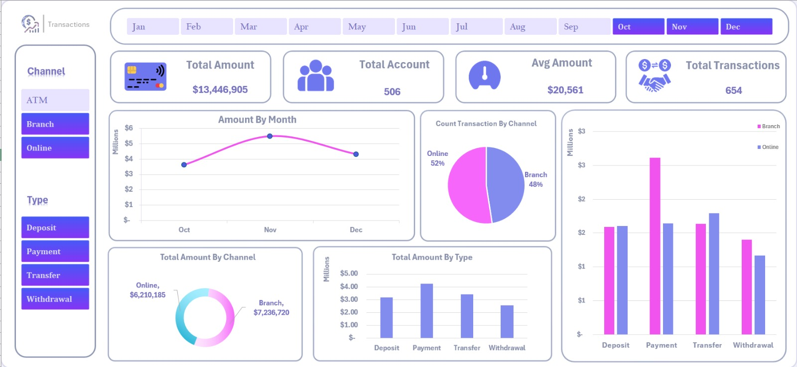

# 💳 Transaction Analysis Dashboard | Excel

## 📌 Project Overview
This project presents an interactive Excel dashboard designed to analyze financial transactions and monitor key transaction metrics.

The dashboard provides an overview of transaction amounts, account activity, transaction volume, and average transaction value.

## 🎯 Project Objectives
- Monitor overall transaction performance.
- Analyze transaction amounts over time.
- Compare transaction activity across different channels.
- Analyze transactions by type.
- Present key metrics through an interactive dashboard.

## 🛠️ Tools & Techniques
- Microsoft Excel
- Pivot Tables
- Charts & Data Visualization
- Interactive Filters
- KPI Cards
- Dashboard Design & Formatting

## 📊 Dashboard Features
- **Overview KPIs:** Total Amount, Total Accounts, Average Amount, and Total Transactions.
- **Monthly Analysis:** Track transaction amounts by month.
- **Channel Analysis:** Compare transaction amounts and counts across channels.
- **Transaction Type Analysis:** Analyze deposits, payments, transfers, and withdrawals.
- **Interactive Filtering:** Explore transaction data using channel, type, and month filters.

## 🖼️ Dashboard Preview

## 💡 Key Takeaway
This project focuses on using Excel to organize transaction data, explore performance across different dimensions, and present key metrics through an interactive dashboard.

## 👤 Author
Mohamed Hesham
